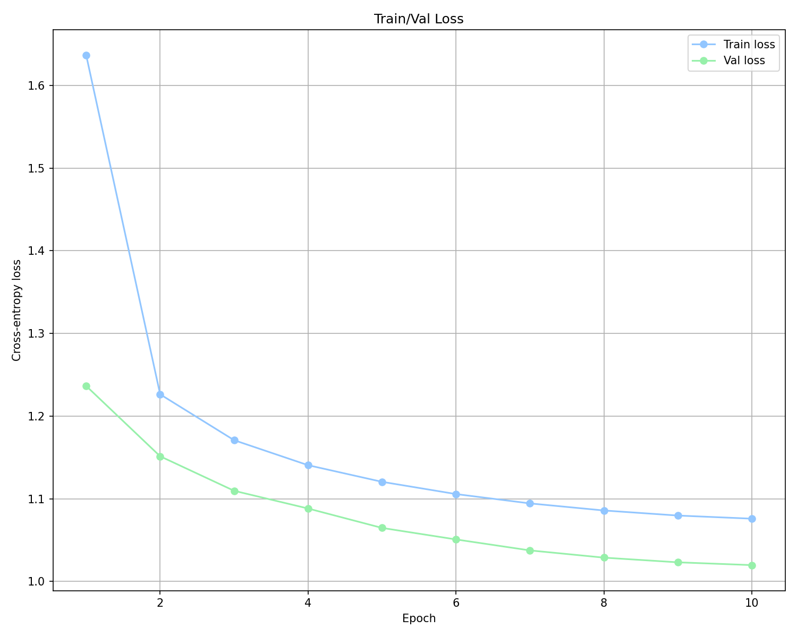
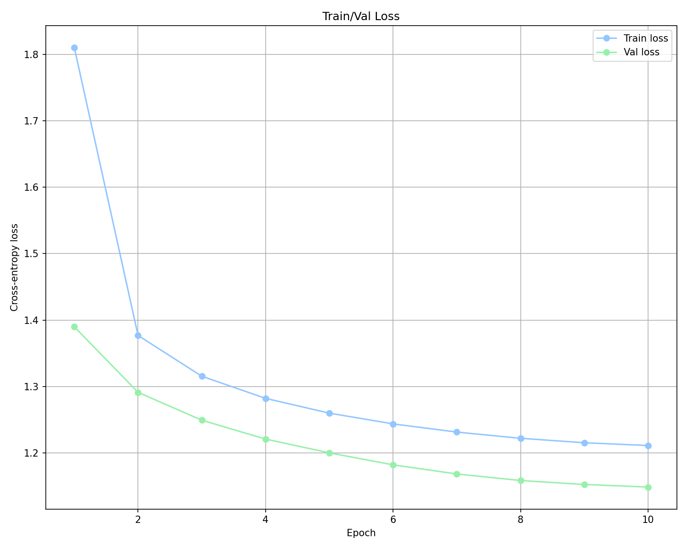
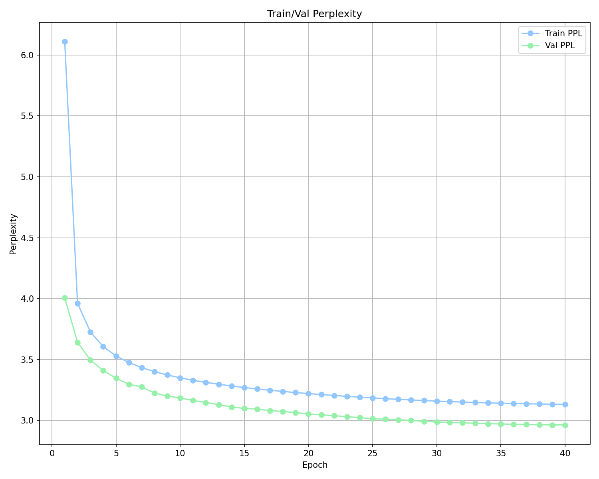

# Recipe GPT

[](https://github.com/angelikizoi/Recipe-Next-Token-Generator/actions/workflows/tests.yml)
[](LICENSE)

A GPT-2-style decoder-only Transformer, trained from scratch to generate cooking recipes from a short list of ingredients. Includes a custom byte-pair-encoding tokenizer built from first principles, a HuggingFace-compatible tokenizer, and full MLflow experiment tracking.

Trained on the [Recipe 2M+ dataset](https://www.kaggle.com/datasets/wilmerarltstrmberg/recipe-dataset-over-2m) (2M+ recipes).

## Pipeline

The project is organized as a linear ML pipeline, one package per stage:

```
config/       Typed dataclass configs (model, data, inference)
data/         Raw CSV -> flat text corpus, offset index, PyTorch Dataset/Sampler/collate
tokenizer/    Two interchangeable tokenizers: a from-scratch BPE trainer, and a HuggingFace BPE trainer
model/        The Transformer_Decoder itself (causal self-attention, tied embeddings, GPT-2-style init)
training/     Training/eval loop, MLflow logging, loss & perplexity curves
inference/    Top-k sampling generation, loadable from any MLflow run
results/      Loss/perplexity curves, sample generations, and metrics from the latest training run
```

Each stage is a runnable module:

```bash
uv sync                                    # install dependencies

python -m data.preprocess                  # CSV -> data/recipe.txt + offset index
python -m tokenizer.hugging_face_tokenizer # trains the HuggingFace BPE tokenizer
python -m tokenizer.custom_tokenizer_train # (optional) trains the from-scratch BPE tokenizer

mlflow server --host 127.0.0.1 --port 5000 &  # tracking server the scripts below expect
python -m training.train                   # trains one model per tokenizer (--tokenizer custom|hug for one), writes results/

python -m inference.generate               # samples recipes; settings in config/inference_config.py

pytest tests/                              # unit tests (no dataset required)
```

All settings live in [config/](config/): [model_config.py](config/model_config.py) (architecture and training hyperparameters), [data_config.py](config/data_config.py) (paths, special tokens, vocabulary size) and [inference_config.py](config/inference_config.py) (prompt, checkpoint, number of samples). Nothing is hardcoded in the pipeline scripts themselves.

### 1. Data

[data/preprocess.py](data/preprocess.py) streams the Kaggle CSV in chunks and writes one recipe per line to `data/recipe.txt`, with special tokens marking its structure:

```
<|TITLE|> {title} <|INGREDIENTS|> {ingredient names} <|DIRECTIONS|> {directions} <|EOS|>
```

It also saves a byte-offset index (`data/recipe_offsets.npy`), so [data/dataset.py](data/dataset.py) can seek straight to any recipe and tokenize it on demand instead of loading the whole corpus into memory. Recipes longer than the context window are truncated, keeping the final `<|EOS|>`.

### 2. Tokenizer

Two BPE tokenizers with a 512-token vocabulary are supported, sharing the same special-token scheme (`<|TITLE|>`, `<|INGREDIENTS|>`, `<|DIRECTIONS|>`, `<|EOS|>`, `<|PAD|>`):

* **Custom** ([tokenizer/custom_tokenizer_train.py](tokenizer/custom_tokenizer_train.py)) — BPE merge-learning implemented from scratch, parallelized across CPU cores with a Count-Min Sketch for approximate pair-frequency counting over the full 2M+ recipe corpus without materializing exact counts in memory. 256 byte tokens + 251 merges + 5 special tokens.
* **HuggingFace** ([tokenizer/hugging_face_tokenizer.py](tokenizer/hugging_face_tokenizer.py)) — the same vocabulary scheme trained via `tokenizers.BpeTrainer`, with a 100-character alphabet + 407 merges + 5 special tokens.

Both use the GPT-4 pre-tokenization regex, and [tokenizer/tokenizer.py](tokenizer/tokenizer.py) wraps them behind one `encode`/`decode` interface, so the rest of the pipeline only needs the tokenizer name.

### 3. Model

* Decoder-only Transformer, GPT-2-style: causal self-attention, pre-LN blocks, tied input/output embeddings, GPT-2 init with depth-scaled residual projections
* Configurable depth/width via `ModelConfig` — the tracked runs use 8 layers, `d_model=256`, 8 heads (~6.8M params) and a 1024-token context window
* Dropout on embeddings, attention weights and both residual projections

### 4. Training

[training/train.py](training/train.py) trains one model per tokenizer under an identical configuration and seed:

* 90/10 train/validation split, drawn from a fixed seed so every run sees the same recipes
* A length-bucketed batch sampler (`SentenceLenSampler`) groups similarly-sized recipes together per batch to minimize padding
* AdamW, gradient clipping, bf16 autocast, and a nanoGPT-style linear-warmup / cosine-decay learning-rate schedule over 40 epochs
* The best epoch by validation loss is restored before writing results

Every run logs to MLflow: hyperparameters, per-epoch train/val loss & perplexity, gradient norms, the best epoch's checkpoint (as `best_model`), and the result artifacts. The same artifacts are written to `results/<tokenizer>/`, along with `latest_run.json` pointing at that checkpoint.

### 5. Inference

[inference/generate.py](inference/generate.py) loads a checkpoint from MLflow (by default the one in `results/<tokenizer>/latest_run.json`) and continues the prompt with top-k sampling (k=50) until the model emits `<|EOS|>`, with the context window as a safety cap. Output is shown either clean or with the structure markers visible.

## Results

40 epochs on a single RTX 5060 Ti:

| tokenizer | val loss | val perplexity | tokens/byte | bits/byte |
|---|---|---|---|---|
| custom BPE | 0.962 | 2.62 | 0.426 | 0.591 |
| HuggingFace BPE | 1.086 | 2.96 | 0.378 | 0.592 |

Per-token loss and perplexity are not comparable across tokenizers, since the custom BPE splits text into more, finer tokens. Bits per byte measures both on the same underlying text. For both tokenizers the best validation loss came at the final epoch (it was still decreasing slightly).

| | custom | HuggingFace |
|---|---|---|
| loss |  |  |
| perplexity |  |  |

Sample generations for both tokenizers are in [results/](results/), as clean text (`sample_generations.txt`) and with the structure markers visible (`sample_generations_raw.txt`).

---

*Built as a from-scratch NLP project: tokenizer, model, training loop, and experiment tracking all implemented without relying on a pre-built GPT implementation.*
